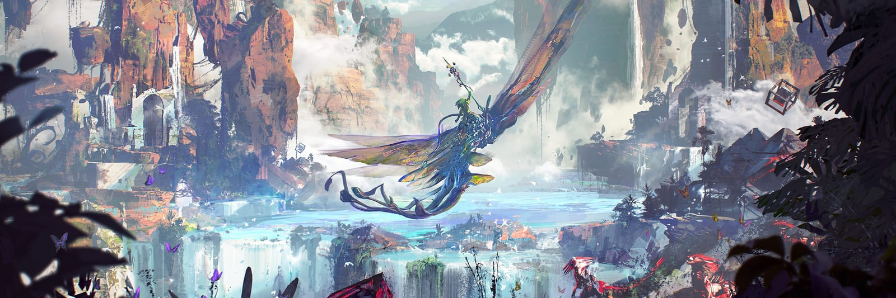
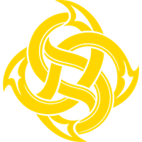
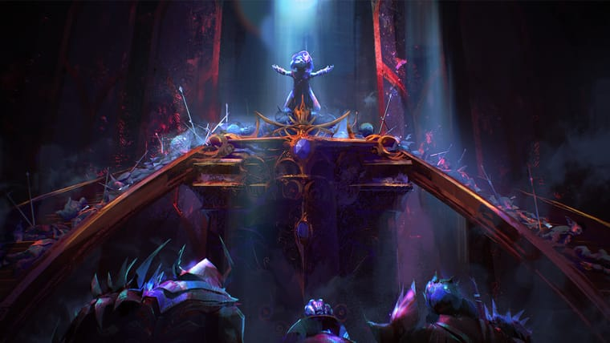
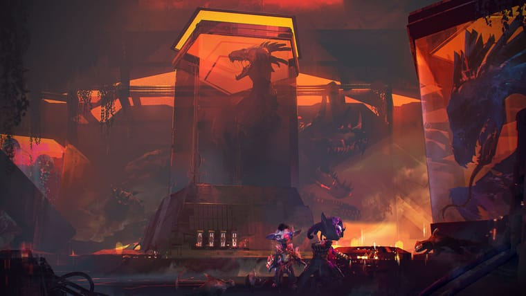
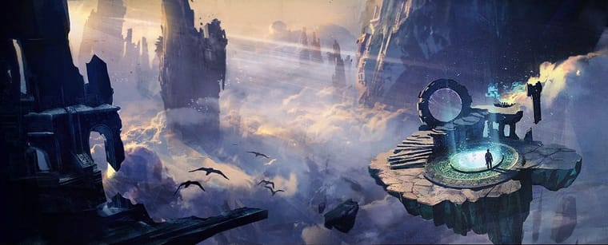
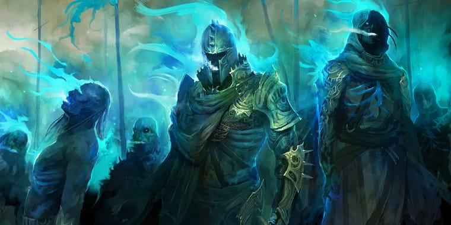
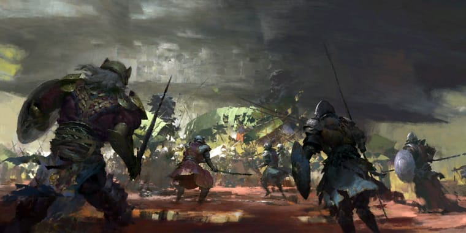

  

  <picture>
    <source media="(prefers-color-scheme: dark)" srcset="assets/readme/logo-escuro.png">
    
  </picture>

<h1 align="center">Guild DIVINE</h1>

  <b>Guias da guilda para Guild Wars 2</b> 
  Fundamentos, builds e mecânicas de Raids, Fractals e Dungeons.

  
  
  

---

## Guias

| | Guia | O que você encontra | |
|:-:|---|---|---|
|  | **[Endgame](https://marcos3g.github.io/divine-gw2-manual/guias/endgame.html)** comece por aqui | Tipos de dano, boons e conditions, atributos, roles, builds, golem de treino, ArcDPS e como entrar em um squad. | [PDF](https://marcos3g.github.io/divine-gw2-manual/pdfs/endgame.pdf) |
|  | **[Raids](https://marcos3g.github.io/divine-gw2-manual/guias/raids.html)** | As 8 wings e os 16 Raid Encounters, recompensas, CM e Legendary Mode, Quickplay e vídeo de cada boss. | [PDF](https://marcos3g.github.io/divine-gw2-manual/pdfs/raids.pdf) |
|  | **[Fractals](https://marcos3g.github.io/divine-gw2-manual/guias/fractals.html)** | Tiers e Agony Resistance, instabilidades, dailies, Account Augmentations, títulos e Challenge Mode. | [PDF](https://marcos3g.github.io/divine-gw2-manual/pdfs/fractals.pdf) |
|  | **[Dungeons](https://marcos3g.github.io/divine-gw2-manual/guias/dungeons.html)** | As 8 dungeons clássicas de Tyria: acesso, recompensas, achievements e vídeo de cada path. | [PDF](https://marcos3g.github.io/divine-gw2-manual/pdfs/dungeons.pdf) |
|  | **[Recursos Úteis](https://marcos3g.github.io/divine-gw2-manual/guias/recursos-uteis.html)** | 56 sites e ferramentas da comunidade: builds, conta, logs, gold, crafting, mapas, WvW e homestead. | [PDF](https://marcos3g.github.io/divine-gw2-manual/pdfs/recursos-uteis.pdf) |

## No site

- Tema **claro e escuro**, que segue o do seu sistema, com botão para trocar.
- Funciona bem no **celular**.
- **Sumário lateral** que acompanha a leitura.
- **PDF** de cada guia para ler offline ou durante o jogo.
- Informações conferidas na [Guild Wars 2 Wiki](https://wiki.guildwars2.com) em novembro de 2026.

## Créditos

- Conteúdo: guilda **DIVINE**, a partir dos guias publicados no Discord da guilda.
- Guild Wars 2 e suas artes são marcas da **ArenaNet**. Imagens: Guild Wars 2 Wiki, wallpapers oficiais do guildwars2.com e artes da guilda.
- Ícones: [Lucide](https://lucide.dev) (ISC). Fontes: Barlow Condensed, Source Sans 3 e IBM Plex Mono (SIL Open Font License).

Este repositório contém o site já pronto, publicado pelo GitHub Pages. Os arquivos-fonte e o guia de edição ficam com quem mantém o site.
